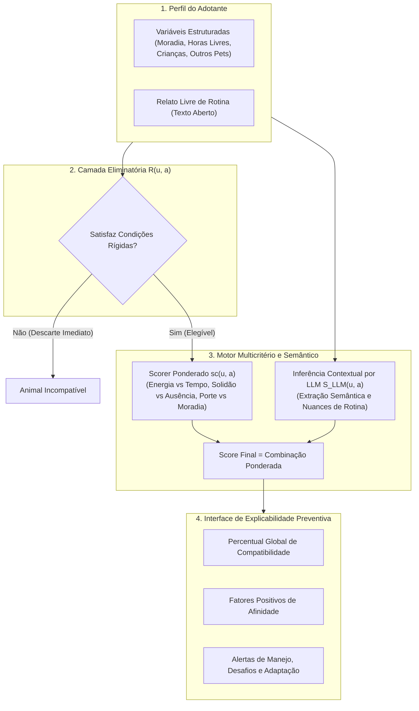

# AdotaMatch — Sistema Inteligente de Recomendação Híbrida e Explicável para Adoção Responsável de Animais

> **Repositório Oficial do Trabalho de Conclusão de Curso (TCC)**  
> **Bacharelado em Ciência da Computação — Centro Universitário Governador Ozanam Coelho (UNIFAGOC)**  
> **Autor:** Gerson Fernandes Ribeiro  
> **Orientador:** Prof. Me. Jacimar  

---

[](https://kotlinlang.org/)
[](https://spring.io/projects/spring-boot)
[](https://vuejs.org/)
[](https://www.typescriptlang.org/)
[](https://primevue.org/)
[](https://tailwindcss.com/)
[](http://localhost:8080/swagger-ui.html)
[](https://unifagoc.edu.br/)

---

## 1. Contexto e Motivação

Estudos sobre bem-estar animal no Brasil indicam que uma parcela alarmante dos animais adotados é devolvida aos abrigos ou reabandonada nos primeiros meses de convivência. As principais causas reportadas pelos abrigos não decorrem de falta de carinho, mas de **incompatibilidades socioambientais e expectativas desalinhadas**:
* Falta de tempo livre do tutor para atender ao nível de energia de animais muito ativos;
* Intolerância à solidão do animal contrastando com longas jornadas de trabalho ou estudos fora de casa;
* Confinamento de animais de grande porte em apartamentos compactos sem área externa;
* Choque comportamental com crianças pequenas ou outros animais já residentes.

As plataformas digitais de adoção vigentes operam quase que exclusivamente como **vitrines virtuais com filtros booleanos rasos** (espécie, idade, cor, porte). Esses filtros desconsideram a dinâmica da rotina do adotante e o prontuário comportamental real do animal.

O **AdotaMatch** foi concebido para transformar esse paradigma, atuando como um **sistema de recomendação ético e preventivo** focado na sustentabilidade do vínculo adotivo.

---

## 2. Arquitetura da Solução

O AdotaMatch implementa um pipeline híbrido de 4 camadas:



### Detalhamento das Camadas

1. **Camada de Restrições Rígidas ($R(u, a) \in \{0, 1\}$):**
   * Descarta de imediato alternativas inviáveis (e.g. cães de grande porte e alta energia em apartamentos sem quintal; candidatos intolerantes a outros pets quando o tutor já possui animais no lar).
2. **Camada de Pontuação Ponderada Multicritério ($s_c(u, a)$):**
   * Compatibiliza matematicamente o tempo diário disponível do tutor com a demanda estimada pelo nível de energia (1 a 5).
   * Calcula o risco de ausência real versus tolerância máxima à solidão em horas (solitaryToleranceHours).
3. **Módulo Semântico e Contextual via LLM ($S_{\text{LLM}}(u, a)$):**
   * Analisa relatos em linguagem natural identificando regimes de trabalho (presencial, híbrido, home office), turnos de estudo (faculdade noturna) e redes de apoio familiar (co-cuidadores).
   * O relato é opcional: caso não preenchido, o sistema atua com máxima precisão matemática baseando-se nas variáveis quantitativas.
4. **Explicabilidade Preventiva (XAI):**
   * Apresenta de forma transparente *por que* aquele animal foi sugerido e quais os cuidados específicos exigidos nos primeiros 30 dias de ambientação.

---

## 3. Estrutura do Repositório (Monorepo)

O projeto está organizado nos seguintes diretórios:

```txt
AdotaMatch/
├── backend/                  # API RESTful Spring Boot + Kotlin 2.0 + JPA + H2
│   ├── src/                  # Código-fonte e testes unitários/E2E
│   ├── pom.xml               # Configurações do Maven e dependências
│   └── README.md             # Documentação técnica completa da API
├── frontend/                 # Aplicação SPA reativa Vue 3 + TypeScript + Tailwind
│   ├── src/                  # Views, stores Pinia, componentes PrimeVue
│   ├── package.json          # Dependências e scripts NPM
│   └── README.md             # Documentação completa da interface
├── artigo-tcc/               # Acervo acadêmico oficial do Trabalho de Conclusão de Curso
│   ├── Artigo_TCC_AdotaMatch_Revisado_UNIFAGOC.md   # Artigo integral em Markdown
│   ├── Artigo_TCC_AdotaMatch_Revisado_Formatado_UNIFAGOC.docx # Versão Word oficial
│   ├── GersonFernandesRibeiro.pdf                   # Versão consolidada em PDF
│   └── README.md             # Resumo e diretrizes acadêmicas
├── specs/                    # Especificações de Engenharia e Negócio (TLC Spec-Driven)
│   ├── 01-business-domain-spec.md
│   ├── 02-system-architecture-spec.md
│   ├── 03-backend-technical-spec.md
│   ├── 04-frontend-technical-spec.md
│   └── 05-recommendation-engine-spec.md
├── design/                   # Protótipos de telas e especificações visuais
├── iniciar-sistema.bat       # Script utilitário para inicialização rápida no Windows
├── constitution.md           # Governança e padrões arquiteturais do projeto
├── agents.md                 # Papéis e convenções para agentes de engenharia
├── .gitignore                # Regras de exclusão de binários e dependências
└── README.md                 # Documentação central do ecossistema
```

---

## 4. Como Executar o Sistema

### Pré-requisitos
* **Java JDK:** Versão 21 ou 22 LTS instalado e configurado no `PATH`.
* **Apache Maven:** Versão 3.9+.
* **Node.js:** Versão 20.x ou superior.

---

### Opção A: Execução Automática (Windows)
Execute o arquivo batch disponível na raiz do repositório:
```cmd
iniciar-sistema.bat
```
O script iniciará automaticamente o backend na porta `8080` e o servidor Vite do frontend na porta `5173`.

---

### Opção B: Execução Manual dos Serviços

#### 1. Backend (Spring Boot)
```bash
cd backend
mvn clean package -DskipTests
java -jar target/adotamatch-backend-1.0.0-SNAPSHOT.jar
```
* **API REST:** `http://localhost:8080/api/v1`
* **Swagger UI:** `http://localhost:8080/swagger-ui.html`
* **H2 Console:** `http://localhost:8080/h2-console` (JDBC URL: `jdbc:h2:mem:adotamatchdb`)

#### 2. Frontend (Vue 3 + Vite)
```bash
cd frontend
npm install
npm run dev
```
* **Aplicação Web:** `http://localhost:5173`

---

## 5. Bateria de Testes Automatizados e População em Massa

O projeto dispõe de uma suíte avançada de testes automatizados E2E localizada em `backend/src/test/kotlin/br/com/adotamatch/e2e/`:

* **`CAutomatedApiE2eTest.kt`:**
  * **Autenticação:** Valida fluxos de Adotante, Protetor Independente e Abrigos parceiros com CNPJ.
  * **Cadastro em Lote de 50 Animais:** Cria **25 cães e 25 gatos** com métricas altamente variáveis (níveis de energia de 1 a 5, tolerância à solidão de 4h a 10h, portes Mini a Grande, idades, fotos reais e diários de comportamento).
  * **Simulação de 5 Personas:** Valida a acurácia dos ranqueamentos para perfis socioespaciais heterogêneos.
  * **Fluxo de Intenção de Adoção:** Submissão e triagem de solicitações.

Para rodar a suíte completa:
```bash
cd backend
mvn test -Dtest=CAutomatedApiE2eTest
```

---

## 6. Autenticação e Perfis de Acesso

O sistema suporta segregação de permissões via tokens JWT:
1. **Adotante (`ADOPTER`):** Realiza simulações personalizadas, consulta detalhes dos animais e envia manifestações de interesse com histórico em `/my-intents`.
2. **Protetor Independente (`GUARDIAN`):** Cadastra animais resgatados, atualiza prontuários e visualiza interessados.
3. **Abrigo / Pet Shop Parceiro (`SHELTER`):** Cadastro institucional com validação de CNPJ, razão social e painel consolidado de triagem em `/shelter-dashboard`.

---

## 7. Referências e Créditos

* **Instituição de Ensino:** Centro Universitário Governador Ozanam Coelho — UNIFAGOC (Ubá - MG).
* **Orientação Acadêmica:** Prof. Me. Jacimar.
* **Metodologia:** TLC Spec-Driven Development.
